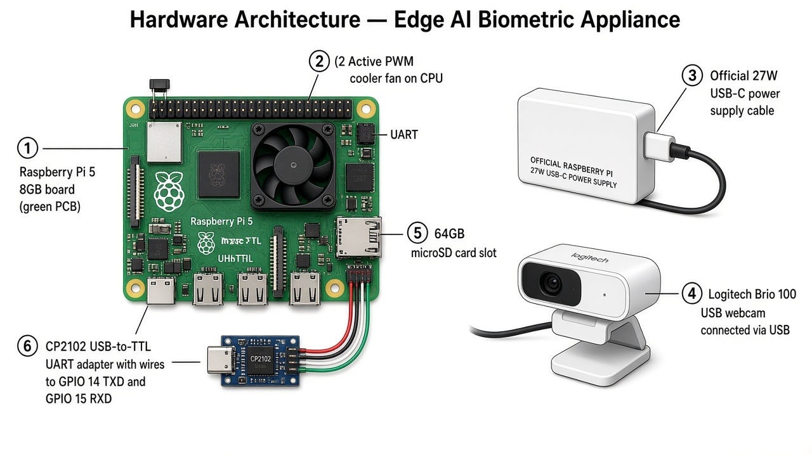

# RESEARCH PROPOSAL

**Autonomous Biometric Edge AI Appliance**  
**Empirical Optimization of Computer Vision, Liveness Verification, and Resilient Storage on ARM64 Embedded Hardware**

| | |
|---|---|
| **Student Researcher** | Duy Anh Huynh (Vincent) |
| **Affiliation** | Grade 12 \| Rabun Gap-Nacoochee School |
| **Research Area** | Computer Science — Embedded Systems, Edge AI & Computer Vision |
| **Technical Advisor** | Huong Nguyen \| Head of AI & Automation, Affina (InsurTech) \| Master in Information Technology \| PhD in Data Analytics (In Progress) \| huong.nguyen3@affina.com.vn |
| **Project Origin** | Independent Exploration & Edge AI Internship \| Affina (InsurTech) \| Ho Chi Minh City, Vietnam |
| **Project Development** | Summer 2026 \| 12-Week Research & Exploration at Affina, including a 4-Week Solution Implementation Phase |

**Online Profile & Code**

- GitHub Repository: https://github.com/caubethieunang4030/myproject.git
- LinkedIn: https://linkedin.com/in/duy-anh-huynh-34b3ab380

**Media Coverage**

- VnExpress International — Education: https://e.vnexpress.net/news/news/education/grade-11-student-develops-edge-ai-attendance-system-from-real-world-problem-5108390.html — “Grade 11 student develops Edge AI attendance system from a real-world problem” \| August 13, 2026

> **Revision marking:** <span style="background-color:#FFFF00;color:#FF0000;">Yellow highlight + red text</span> = content to review/correct with final measured numbers before submission. Original intent is preserved.

---

## PROJECT OVERVIEW

**ORIGINAL AIM**  
My father wanted an app so older people could scan a plant and have its disease recognized, because my grandmother has a garden. I was far away, and collecting leaf samples and examples of each disease was too difficult, so that app was not built. Before I joined Affina, I turned to a face check-in for students in Vietnam's mountain areas: store each arrival and departure, read the absence pattern, and leave time to help a student who might leave school. There was no real attendance data from those students and no real test with them. The work that was finished, and that this proposal evaluates, is the face check-in built during a summer internship at Affina. It records attendance. It does not predict who will drop out.

**PROJECT GOAL**  
Develop and evaluate an autonomous, on-premise Edge AI biometric attendance appliance running on Raspberry Pi 5.

**CORE SOLUTION**
- Threaded V4L2/MJPG Camera Ingestion
- 1434-D MediaPipe Facial Mesh Matching
- Heuristic Liveness Verification
- SQLite WAL Offline-First Storage

**RESEARCH FOCUS**
- Recognition Accuracy
- Throughput & Latency
- 2D Presentation-Attack Resistance
- Storage Reliability

**KEY TECHNOLOGIES**
- Raspberry Pi 5
- Python
- OpenCV
- MediaPipe
- V4L2/MJPG
- SQLite WAL
- Fernet Encryption (AES-128-CBC + HMAC)

**EVALUATION TARGETS**
- <span style="background-color:#FFFF00;color:#FF0000;">TAR ≥98.5%</span>
- <span style="background-color:#FFFF00;color:#FF0000;">30 FPS</span>
- <span style="background-color:#FFFF00;color:#FF0000;">&lt;150 ms Latency</span>
- <span style="background-color:#FFFF00;color:#FF0000;">APCER ≤3% Paper / ≤5% Screen</span>
- <span style="background-color:#FFFF00;color:#FF0000;">Zero Record Loss during Simulated Outages of up to 48 Hours</span>

\*Proposed evaluation targets; final performance will be determined through empirical testing.

---

## 1. PROJECT SUMMARY & ABSTRACT

Biometric attendance systems in educational institutions and small-to-medium enterprises (SMEs) face major operational challenges: cloud-based solutions expose student biometric data to external networks and fail during broadband outages, while naive desktop vision code deployed to single-board computers (SBCs) suffers from camera driver latency, high CPU load, and vulnerability to 2D photo presentation attacks.

This research proposes the design, empirical optimization, and validation of an autonomous, on-premise Edge AI Biometric Appliance running on the ARM64-based Raspberry Pi 5. Based on actual codebase implementation, this project addresses hardware and software constraints through a four-part architecture:

1. **Decoupled Threaded V4L2 MJPG Frame Ingestion:** A background `ThreadedCamera` worker thread uses native Linux V4L2 MJPG hardware decoding with `CAP_PROP_BUFFERSIZE = 1` at 1280×720@30 FPS (downscaled to 640×480 for inference), eliminating image buffer lag.

2. **Normalized 1434-D Facial Mesh Vector Matching:** MediaPipe Face Mesh extracts 478 3D landmarks (478×3=1434 values). Vectors are centered to the origin (0,0,0) and L2-normalized into unit vectors (`normalize_vector`). Identity matching is performed via batch matrix Cosine Distance (`Distance=1−M⋅v`) with a calibrated distance threshold of `COSINE_THRESHOLD = 0.025` (≥97.5% similarity).

3. **Two-Tier Heuristic Liveness Engine & Enrollment Verification:** Real-time liveness checks combine 3D cranial Z-depth dispersion (σ<sub>z</sub> > 0.015 across 5 rigid landmarks) and dynamic temporal motion tracking normalized by Inner Canthus Distance (ICD) across 3 consecutive frames. During student enrollment, a 3-angle pose capture (straight, left, right) verifies dynamic Eye Aspect Ratio (EAR) blink transitions (EAR&lt;0.15 → EAR&gt;0.22).

4. **SQLite WAL Persistence & Resilient JSON Sync Daemon:** Check-in records and student vectors persist to an embedded SQLite database running in Write-Ahead Logging (WAL) mode (`PRAGMA journal_mode=WAL;`). Biometric vectors are encrypted at rest using AES-based Fernet symmetric encryption (`ENCRYPTION_KEY` in `.env`). In network/database lock scenarios, records drop to an atomic `offline_queue.json` file managed by a background sync daemon thread (`sync_offline_queue`) polling every 10 seconds.

The appliance will be benchmarked on public academic datasets (LFW) and deployed in an 8-week pilot with 50 voluntary participants under formal institutional consent.

### 1.1 Four Core Techniques — What / How / Why (Project Contribution)

For a reader who did not write the code: each technique owns one job in the appliance.

**Technique A — Threaded V4L2/MJPG Camera Ingestion**  
*What:* A dedicated background thread that always keeps the newest camera frame.  
*How:* Linux V4L2 + webcam MJPG hardware compression; `BUFFERSIZE = 1` so old frames are not queued (this removed the ~2 s lag on Pi 5). Capture stays 1280×720 for display; AI runs on 640×480.  
*Contribution:* Without low-latency capture, recognition and liveness run on stale video — the other three techniques cannot work in a real hallway.

**Technique B — 1434-D MediaPipe Facial Mesh Matching**  
*What:* A privacy-preserving face “fingerprint” of 1434 numbers, not a stored photo.  
*How:* 478 3D landmarks → center to origin → L2 unit vector → Cosine Distance ≤ 0.025 means same person.  
*Contribution:* This is the identity engine: answers “who is this?” on ARM64 without a GPU, and supports storing only encrypted vectors.

**Technique C — Heuristic Liveness Verification**  
*What:* Two live checks plus blink-at-enrollment to reject paper/phone spoofs.  
*How:* (1) Z-depth spread on five rigid skull landmarks; (2) ICD-normalized micro-motion over 3 frames; (3) EAR blink closed→open during registration.  
*Contribution:* Recognition alone can be fooled by a photo. Liveness protects attendance integrity and blocks fake enrollments.

**Technique D — SQLite WAL Offline-First Storage (+ Fernet)**  
*What:* Local encrypted database that still accepts check-ins when network/DB path fails.  
*How:* WAL for concurrent read/write; fallback `offline_queue.json` with atomic rename/merge every 10 s; Fernet AES-128-CBC + HMAC on vectors.  
*Contribution:* Completes the appliance claim: privacy at rest + zero lost morning check-ins during outages.

---

## 2. PROBLEM STATEMENT & RESEARCH OBJECTIVES

### 2.1 Background & Context

Centralized cloud attendance systems continuously transmit facial telemetry over wide-area networks (WAN). This creates three primary issues:

- **Privacy Risks:** Transmitting unencrypted facial data violates FERPA (34 CFR Part 99) and BIPA (740 ILCS 14/) privacy standards.
- **Network Dependence:** Network dropouts halt check-in operations during peak morning arrival hours.
- **Continuous Cost:** SaaS subscriptions generate ongoing operational expense for schools.

Desktop computer vision scripts using `dlib` or uncompressed camera feeds fail on embedded Linux: YUYV video streams saturate USB bandwidth, causing a 2-second visual delay, and simple image blur filters (Laplacian variance) are easily bypassed by crisp smartphone photographs.

### 2.2 Research Questions

1. How can an ARM64 single-board computer achieve sub-150ms biometric recognition at 30 FPS using normalized 3D facial landmark vectors without requiring a discrete GPU?
2. How effectively can a two-tier heuristic combining Z-depth dispersion (σ<sub>z</sub>) and ICD-normalized temporal motion detect 2D paper print and mobile screen presentation attacks without active depth hardware?
3. How can an offline-first hybrid storage architecture combining SQLite WAL mode with a thread-locked atomic JSON queue ensure 100% record recovery during network disruptions exceeding 48 hours?

### 2.3 Specific Measurable Objectives

- **Recognition Accuracy:** <span style="background-color:#FFFF00;color:#FF0000;">True Accept Rate (TAR) ≥98.5% at Cosine Distance ≤0.025 (≥97.5% similarity).</span>
- **Throughput & Latency:** <span style="background-color:#FFFF00;color:#FF0000;">Sustained frame capture at 30 FPS with total single-subject identification latency under 150ms.</span>
- **Spoofing Resistance:** <span style="background-color:#FFFF00;color:#FF0000;">Attack Presentation Classification Error Rate (APCER) ≤3.0% for paper prints and ≤5.0% for mobile screen replays.</span>
- **Storage Reliability:** <span style="background-color:#FFFF00;color:#FF0000;">100% log recovery with zero dropped check-in records across simulated 48-hour network outages.</span>

---

## 3. PRELIMINARY WORK & LESSONS LEARNED (CODEBASE EVOLUTION)

Deployment testing on a Raspberry Pi 5 running Debian Bookworm exposed concrete technical challenges that shaped the codebase implementation:

**Dependency & ABI Failures**  
*Observed Roadblock:* `dlib` compilation failed due to missing AVX instructions; `numpy` 2.x crashed MediaPipe C-extensions.  
*Implemented Code Solution:* Pinned dependencies in `requirements-rpi5.txt` (`1.24.0 <= numpy < 2.0.0`, `mediapipe>=0.10.9,<0.10.20`), automated via `setup_rpi5.sh`. Supported MediaPipe Tasks API (`face_landmarker.task`) fallback in `main.py`.

**Camera Driver Latency (2s Lag)**  
*Observed Roadblock:* Default V4L2 queue accumulated uncompressed YUYV frames over USB.  
*Implemented Code Solution:* Created `ThreadedCamera` (`core/camera_stream.py`) using V4L2 backend (`cv2.CAP_V4L2`), forcing MJPG encoding (`cv2.VideoWriter_fourcc(*'MJPG')`) and setting `CAP_PROP_BUFFERSIZE = 1`.

**High CPU Consumption**  
*Observed Roadblock:* Processing full 1280×720 camera frames through MediaPipe consumed excessive CPU resources on Raspberry Pi 5.  
*Implemented Code Solution:* Separated capture resolution (1280×720) from process resolution (`PROCESS_WIDTH = 640`, `PROCESS_HEIGHT = 480`) in `config.py`.

**Passive Blur Filter Limitations**  
*Observed Roadblock:* High-resolution phone screens easily passed Laplacian variance sharpness checks.  
*Implemented Code Solution:* Built two-tier biological liveness checks in `core/utils.py`: Z-depth dispersion (σ<sub>z</sub> > 0.015) and ICD-normalized temporal motion tracking (`temporal_motion_tracker`).

**SQLite Concurrency & Lockouts**  
*Observed Roadblock:* Concurrent thread access caused database locking during peak check-in logging.  
*Implemented Code Solution:* Enforced SQLite Write-Ahead Logging (`PRAGMA journal_mode=WAL;`) and created `save_offline_log()` fallback writing to `offline_queue.json`.

---

## 4. SYSTEM / SOFTWARE ARCHITECTURE AND METHODOLOGY

### 4.0 Repository & File-Management Architecture (Monorepo)

This project uses a **monorepo**: one Git repository holds the appliance runtime, helper scripts, Pi setup tooling, docs, and figures together.

```text
myproject/
├── main.py                 # camera → mesh → liveness → match → storage
├── delete_student.py       # privacy / opt-out purge tool
├── sync_to_web.py          # optional SQLite → web API sync (Pi path)
├── config.py               # resolutions, COSINE_THRESHOLD, cooldown
├── setup_rpi5.sh           # Raspberry Pi OS bootstrap
├── requirements.txt / requirements-rpi5.txt
├── core/                   # camera_stream, utils (normalize, liveness)
├── docs/                   # this proposal + figures
└── images/                 # early still-image matching samples
```

**Why monorepo (not polyrepo / multi-package SDK)?**  
Polyrepo would split camera code, docs, and setup scripts across repositories and cause version drift for a solo student researcher. A publishable multi-package SDK is premature — the deliverable is an integrated appliance. Monorepo keeps thresholds, schema, setup, and methodology in one commit history, matching how the system was tuned (see §5).

### 4.1 Hardware Architecture



- **Single-Board Computer:** Raspberry Pi 5 (8GB LPDDR4X, Broadcom BCM2712 Quad-Core ARM Cortex-A76 @ 2.4GHz) with active PWM fan cooling.
- **I/O Routing:** Custom RP1 Controller managing USB 3.0/2.0 packet traffic.
- **Optical Sensor:** Logitech Brio 100 USB Webcam (Configured at 1280×720 @ 30 FPS, hardware MJPG FourCC codec).
- **Out-of-Band Debugging:** CP2102 USB-to-TTL adapter connected to GPIO 14 (TXD) and GPIO 15 (RXD) at 115,200 baud for headless UART console recovery.
- **Storage Medium:** 64GB MicroSD (A2/U3) holding OS, code, SQLite DB, and offline queue.

### 4.2 Vision Processing & Facial Vector Normalization

**Threaded Capture (`core/camera_stream.py`):** The `ThreadedCamera` class runs a background thread polling `cv2.VideoCapture`. Setting `CAP_PROP_BUFFERSIZE = 1` ensures only the latest frame is retained, eliminating ring buffer queue delays.

**Dual-Resolution Pipeline:** The camera captures at `DISPLAY_WIDTH = 1280` × `DISPLAY_HEIGHT = 720` for display output. For MediaPipe inference, frames are resized to `PROCESS_WIDTH = 640` × `PROCESS_HEIGHT = 480`, lowering CPU load on the Raspberry Pi 5.

**Facial Landmark Extraction:** MediaPipe Face Mesh detects 478 3D facial landmarks (478×3=1434 values).

**Vector Normalization (`normalize_vector` in `core/utils.py`):**
- Landmark coordinates are scaled to pixel space (x⋅w, y⋅h, z⋅w).
- The centroid is shifted to origin (0,0,0) by subtracting the mean coordinate vector: *v<sub>centered</sub> = v − v̄*
- The vector is flattened into 1434 dimensions and L2-normalized: *v<sub>norm</sub> = v<sub>flat</sub> / ‖v<sub>flat</sub>‖₂*

**Batch Cosine Distance Matching (`batch_cosine_distance` in `core/utils.py`):** Candidate vectors stored in memory matrix *M* (N×1434) are compared against the normalized query vector *v<sub>norm</sub>* (1434×1) via matrix dot product:

*Distance = 1.0 − (M · v<sub>norm</sub>)*

A match is declared when Distance ≤ `COSINE_THRESHOLD = 0.025` (corresponding to ≥97.5% similarity).

### 4.3 Two-Tier Liveness Verification & Enrollment Check

For a non-engineer reader: the system does **not** store photographs. It tracks a digital “skeleton” of numbered face-mesh points. Some points act like **rigid bones** (skull structure that should show real 3D depth). Others track **eye motion** (blinks). Together they answer whether a living person is present, or someone is holding a flat picture / phone.


**Tier 1: Z-Depth Dispersion Check (`check_depth_liveness`)**
- Extracts Z-axis coordinates across 5 rigid skeletal landmarks: Forehead (10), Chin (152), Nose Tip (4), Left Inner Canthus (133), Right Inner Canthus (362).
- Computes standard deviation σ<sub>z</sub> = std(z<sub>rigid</sub>). Frames with σ<sub>z</sub> ≤ 0.015 represent flat 2D planar surfaces (paper prints or screens) and are rejected.
- **Why these bones matter:** On a live head, nose tip Z differs from forehead/chin Z. On a print/screen, depth collapses → reject before identity matching runs.

**Tier 2: ICD-Normalized Temporal Motion Tracking (`temporal_motion_tracker`)**
- Maintains a rolling buffer of 3 consecutive frames tracking key landmarks (Nose 4, Eyes 133/362, Lips 13/14).
- Landmark movement is normalized by Inner Canthus Distance (ICD = ‖p<sub>133</sub> − p<sub>362</sub>‖₂) to handle distance variation.
- Filters out camera sensor noise (Motion &lt; 0.002) and static photos, requiring average motion Motion &gt; 0.015 for biological liveness confirmation.

**Interactive Enrollment Verification (`extract_liveness_features`)**
- Student enrollment requires capturing 3 distinct poses (straight, left, right).
- During the straight pose capture, the system enforces dynamic blink verification by measuring Eye Aspect Ratio (EAR):

*EAR = ‖p<sub>159</sub> − p<sub>145</sub>‖₂ / ICD*

- Enforces state transition from closed eyes (EAR &lt; 0.15) to open eyes (EAR &gt; 0.22) before accepting enrollment vectors.
- **Why eye motion matters:** A printed photo cannot execute a closed→open blink on command, blocking fake registration as well as fake check-in. Glasses edge cases were fixed in commit `00b46f6`.

### 4.4 SQLite WAL Persistence & Atomic Offline Queue Daemon

**Why this design:** The appliance must survive (1) no always-on network, (2) concurrent camera + sync threads, and (3) biometric privacy if the microSD is removed. That combination favors embedded offline-first SQLite plus encrypted vectors — not “remote SQL Server only.”

**Why SQLite + WAL**
- SQLite file on device (`database.db`): zero server install on Pi; easy purge after defense.
- `PRAGMA journal_mode=WAL;`: readers (load vectors) do not block writers (insert attendance) during morning rush — the exact lockout mode observed earlier.
- Not pure JSON/CSV alone: need indexed IDs, transactions, and concurrent access.

**Database Schema**
- `vectormathocsinh`: Stores student ID (`mahocsinh`), student name (`tenhocsinh`), and Fernet-encrypted JSON vector strings (`facevector`).
- `thongtinchamcong`: Stores attendance records (`id`, `mahocsinh`, `loai_chamcong`, `thoigianquet`).

**Why Fernet / AES-128 (and this processing path)**  
Vector JSON strings are encrypted using Fernet (`cryptography.fernet.Fernet` with **128-bit AES-CBC** and HMAC authentication). The `ENCRYPTION_KEY` is loaded from `.env` (automatically generated on first run).

- Encrypt at rest so a stolen microSD does not expose readable templates.
- Prefer Fernet over hand-rolled AES-256: correct IV handling + authentication; light enough for small JSON vectors on Pi 5.
- Encrypt only the vector payload (not the whole DB) for fast inserts; decrypt into RAM for matching; never commit `.env`.

**Atomic Offline Fallback Queue (`save_offline_log` & `sync_offline_queue`)**
- If SQLite connection fails or offline mode triggers, check-in entries are appended to `offline_queue.json` under `offline_lock` protection.
- A background thread (`sync_offline_queue`) polls every 10 seconds.
- **Step 1:** Safely renames `offline_queue.json` → `offline_queue_sync.json`.
- **Step 2:** Reads queued records and batch-inserts them into SQLite `thongtinchamcong` within a single transaction (`conn.commit()`).
- **Step 3:** Deletes `offline_queue_sync.json` upon success. On failure, un-synced records are safely merged back into `offline_queue.json` to prevent data loss (race fixed in commit `8693d69`).

---

## 5. EXPERIMENTAL DESIGN, ETHICS & PRIVACY

### 5.0 Experimental Goal

The primary experimental goal is **anti-spoofing (presentation-attack) resistance under realistic conditions**, while confirming the appliance still **functions end-to-end** (enroll → recognize → log → recover offline). In practice: try to fool the system with paper/phone attacks, tune coefficients toward a sweet spot where real students pass and spoofs fail, then record functional pass rate and every bug fix from that process.

### 5.1 Presentation Attack Testing Protocol

**2D Paper Print Attack**
- **Setup:** Color portrait photos printed on matte/glossy paper (1:1 scale).
- **Evaluation:** Evaluated against Z-depth dispersion (σ<sub>z</sub> ≤ 0.015) and temporal motion thresholds.
- **Target Metric:** <span style="background-color:#FFFF00;color:#FF0000;">APCER ≤3.0%.</span>

**2D Mobile Screen Replay Attack**
- **Setup:** High-resolution video playback on smartphone screens.
- **Evaluation:** Evaluated against ICD-normalized motion tracking and dynamic EAR blink curve transitions.
- **Target Metric:** <span style="background-color:#FFFF00;color:#FF0000;">APCER ≤5.0%.</span>

### 5.2 Coefficient Tuning Process (Sweet Spot) & Functional Tests

Thresholds were not chosen on day one. They were moved in small steps, guided by false accepts vs false rejects. Git history is the lab notebook:

| Stage | Change | Why | Next move |
|---|---|---|---|
| Early matching | ~0.25 | Need recognitions at all | Too loose → cross-ID risk |
| `65b739e` | → ~0.18 + distance debug | Stop wrong-student matches | Better separation |
| `b295e50` | Pixel normalization + blink enroll; → 0.13 | Photos still too close in vector space | Stronger anti-photo; some real rejects |
| `5e65629` | → 0.15 | Recover TAR for real students | Temporary operating point |
| Later Edge path | → `COSINE_THRESHOLD = 0.025` | With L2 unit vectors, tighter angular gate is meaningful | <span style="background-color:#FFFF00;color:#FF0000;">Confirm final TAR/FAR on trial sheet</span> |
| Depth / motion / EAR | σ<sub>z</sub>=0.015; noise=0.002; human=0.015; EAR 0.15→0.22 | Separate flat media + require blink | Glasses fix `00b46f6` |

**Functional test cases (fill measured pass % before submission)**

| ID | Test case | Expected | Status |
|---|---|---|---|
| F01 | Cold start Pi + camera | Preview within warm-up | <span style="background-color:#FFFF00;color:#FF0000;">__/__ = __%</span> |
| F02 | Enroll 3 poses + blink | Encrypted vector row | <span style="background-color:#FFFF00;color:#FF0000;">__/__ = __%</span> |
| F03 | Genuine check-in | Attendance row written | <span style="background-color:#FFFF00;color:#FF0000;">__/__ = __%</span> |
| F04 | Paper-print attack | Rejected by liveness | <span style="background-color:#FFFF00;color:#FF0000;">__/__ = __%</span> |
| F05 | Phone-screen attack | Rejected by liveness/EAR | <span style="background-color:#FFFF00;color:#FF0000;">__/__ = __%</span> |
| F06 | Wrong-person attempt | No attendance write | <span style="background-color:#FFFF00;color:#FF0000;">__/__ = __%</span> |
| F07 | Simulated DB failure | Row in `offline_queue.json` | <span style="background-color:#FFFF00;color:#FF0000;">__/__ = __%</span> |
| F08 | Restore / sync path | Queue drains into SQLite | <span style="background-color:#FFFF00;color:#FF0000;">__/__ = __%</span> |
| F09 | Opt-out `delete_student.py` | Records removed | <span style="background-color:#FFFF00;color:#FF0000;">__/__ = __%</span> |
| F10 | 15-min cooldown | Duplicate taps suppressed | <span style="background-color:#FFFF00;color:#FF0000;">__/__ = __%</span> |

<span style="background-color:#FFFF00;color:#FF0000;">Overall functional pass rate: __ / __ = __% — replace before submission.</span>

**Defects encountered and fixes (commit-backed):** ~2 s lag → MJPG + threaded buffer=1; NumPy/MediaPipe ABI crash → pin `requirements-rpi5.txt`; glasses blink fail → `00b46f6`; wrong student match → progressive threshold + L2 norm; UI freeze on terminal input → async input (`6f50536`); offline race/loss → atomic rename/merge (`8693d69`); static Fernet fallback → removed (`8693d69`).

### 5.3 Two-Stage Validation Strategy

- **Stage 1: Public Dataset Benchmark (Weeks 3–4):** Evaluate vector matching accuracy and Cosine Distance thresholds on the Labeled Faces in the Wild (LFW) dataset.
- **Stage 2: Institutional Pilot Deployment (Weeks 9–10):** <span style="background-color:#FFFF00;color:#FF0000;">Deploy the physical appliance in a common area at Rabun Gap-Nacoochee School for an 8-week pilot with 50 voluntary participants.</span>

### 5.4 Ethics, Consent & Legal Compliance

- **Institutional Approval:** <span style="background-color:#FFFF00;color:#FF0000;">Testing protocols will be submitted to school administration for capstone ethics review prior to participant enrollment.</span>
- **Regulatory Compliance:** <span style="background-color:#FFFF00;color:#FF0000;">Aligns with FERPA (34 CFR Part 99) and BIPA (740 ILCS 14/) guidelines regarding biometric data handling.</span>
- **Informed Written Consent:** <span style="background-color:#FFFF00;color:#FF0000;">All 50 participants (and parental signatures for minors) must sign an Informed Consent Form explicitly stating:</span>
  - Only 1434-D mathematical landmark coordinate vectors are stored; no raw photographs or video files are saved.
  - Stored vectors are encrypted using Fernet (AES-128) keys stored in `.env`.
  - Participation is voluntary, and participants may opt out at any time (which executes `delete_student.py` to delete database records).
  - All records will be purged upon completion of the capstone defense.

---

## 6. PROJECT TIMELINE, BUDGET & FUTURE SCOPE

### 6.1 12-Week Project Development Timeline

The project developed during Summer 2026 through a 12-week research and exploration period at Affina InsurTech Company, beginning with observation of real-world operational workflows and identification of practical attendance-management challenges. These observations led to the development of an Edge AI-based biometric attendance concept, followed by technical research, architecture design, and a four-week solution implementation and testing phase at Affina.

| PHASE | TIMELINE | DEVELOPMENT ACTIVITIES |
|---|---|---|
| 1. Industry Exploration & Problem Discovery | Week 1 | Explored real-world attendance and workforce-management workflows at Affina, observed operational processes, and identified practical challenges involving attendance verification, connectivity, privacy, and opportunities for on-device automation. |
| 2. Exploration, Setup, Benchmark Preparation & Ethics | Week 2–4 | Investigated Edge AI and embedded computer vision as potential solutions. OS configuration, environment setup (`setup_rpi5.sh`), consent form collection. V4L2 MJPG `ThreadedCamera` tuning, MediaPipe mesh ingestion, and **LFW / matching data tests** (threshold sweeps). |
| 3. Liveness Heuristic Tuning & Anti-Spoof Data Tests | Week 5–6 | Z-depth dispersion tuning, ICD motion tracker calibration, EAR blink verification testing; **paper-print & phone-screen attack trials**; coefficient sweet-spot tuning. |
| 4. Storage Resilience & Offline Queue Tests | Week 7–8 | SQLite WAL schema setup, Fernet encryption integration, and **48-hour offline queue sync testing**. |
| 5. Functional Regression + On-Premise Pilot / Solution Implementation at Affina | Week 9–10 | <span style="background-color:#FFFF00;color:#FF0000;">Hardware deployment (N=50), live attendance logging, performance/thermal profiling; full functional suite F01–F10.</span> |
| 6. Capstone Defense, Metric Lock-in & Data Purge / Testing, Optimization & Technical Documentation at Affina | Week 11–12 | <span style="background-color:#FFFF00;color:#FF0000;">Experimental metric compilation, final oral defense, and complete cryptographic database purge.</span> |

### 6.2 Hardware Bill of Materials (BOM) & Direct Project Cost

| COMPONENT | TECHNICAL SPECIFICATION | PROCUREMENT SOURCE | DIRECT COST |
|---|---|---|---|
| Compute Core | Raspberry Pi 5 (8GB LPDDR4X), Broadcom BCM2712 @ 2.4GHz | <span style="background-color:#FFFF00;color:#FF0000;">Academic Lab Loan (School Inventory)</span> | $0.00 |
| Power & Thermal | Official Raspberry Pi 27W USB-C Power Supply + Active Cooler Fan | <span style="background-color:#FFFF00;color:#FF0000;">Academic Lab Loan (School Inventory)</span> | $0.00 |
| Optical Camera | Logitech Brio 100 HD USB Webcam (1280×720 @ 30 FPS MJPG) | Direct Out-of-Pocket Purchase | $35.00 |
| Storage Medium | 64GB MicroSD Class 10 (A2/U3) | Personal Inventory | $0.00 |
| Serial Debugging | CP2102 USB-to-TTL Adapter (UART Debugging) | Personal/Lab Inventory | $0.00 |
| **TOTAL DIRECT PROJECT EXPENDITURE** | | | **$35.00** |

---

## 7. REFERENCES & TECHNICAL RESOURCES

**Company & Project Context**
- Affina Vietnam (InsurTech) — Official website: https://www.affina.com.vn

**Project Media Coverage**
- VnExpress International — Education. “Grade 11 student develops Edge AI attendance system from a real-world problem.” August 13, 2026. https://e.vnexpress.net/news/news/education/grade-11-student-develops-edge-ai-attendance-system-from-real-world-problem-5108390.html

**Academic & Technical References**
1. Lugaresi, C., et al. (2019). MediaPipe: A Framework for Building Perception Pipelines. arXiv preprint arXiv:1906.08172.
2. Soukupová, T., & Čech, J. (2016). Real-Time Eye Blink Detection using Facial Landmarks. Computer Vision Winter Workshop.
3. Rosebrock, A. (2015). Increasing webcam FPS with Python and OpenCV. PyImageSearch.
4. SQLite Consortium. (2024). Write-Ahead Logging (WAL) Mode Specification. SQLite Official Documentation.
5. Python Cryptography Authority. (2024). Fernet (Symmetric Encryption) Specification. PyCA Documentation.
6. Linux TV Developers. (2024). Video for Linux Two (V4L2) API Driver Specification. Linux Kernel Documentation.
7. Huang, G. B., et al. (2007). Labeled Faces in the Wild: A Database for Studying Face Recognition in Unconstrained Environments. University of Massachusetts Technical Report.
8. U.S. Department of Education. (2021). Family Educational Rights and Privacy Act (FERPA) Regulations: 34 CFR Part 99.
9. General Assembly of the State of Illinois. (2008). Biometric Information Privacy Act (BIPA): 740 ILCS 14/.

**Video Technical Resources & Reference Links**
- Database platform and systems: https://www.youtube.com/watch?v=V7ZU0RKtSoQ
- Architecture and programming technique: https://www.youtube.com/watch?v=uHpzKcm8qh0
- Data processing and the backend system: https://www.youtube.com/watch?v=cv7EPNXXTxA
- Video Streaming & Camera Protocols: https://www.youtube.com/watch?v=_FErnBwMpj8
- System deployment and optimization: https://www.youtube.com/watch?v=4FWrmuKQq1s
- Linux Kernel & Hardware Interfaces: https://www.youtube.com/watch?v=sRNN_wvw1Zo
- Object detection for Web — ML on Web with MediaPipe (Episode 1 → 12): https://www.youtube.com/watch?v=LF7Lgz4_lus
